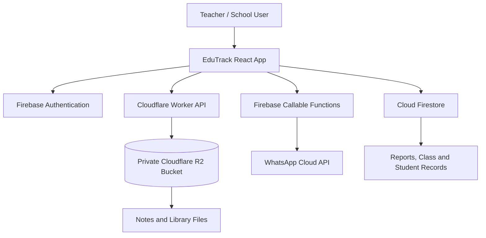

<div align="center">

# 🎓 EduTrack

### Intelligent School Management & Reporting Platform

**Manage classes, student attendance, fees, academic reports, study materials, and school communication from one workspace.**


**Classes · Attendance · Fees · Reports · Analytics · Notes Library · Alerts**

</div>

---

## 🌟 About EduTrack

EduTrack is a school management and academic reporting application designed to bring everyday school workflows into one place. Teachers can organize classes and student records, record attendance, manage fee information, review academic performance, prepare monthly reports, and maintain a class-based library of learning resources.

The platform uses Firebase for authentication and application data, Firebase Cloud Functions for trusted backend workflows, and Cloudflare R2 for file storage used by Notes & Library. The frontend can be hosted separately, for example on Vercel.

> **Project principle:** Keep each school's data scoped to its own authenticated tenant, keep private storage private, and use server-side checks for operations that should not be trusted to the browser.

## Teacher Portal access model

Teacher Portal features are granted by the Academy Admin through the teacher's active, email-verified Academy membership and its boolean permission map. Teachers do not purchase a separate subscription or add-ons to unlock Academy modules. Platform/SaaS Super Admin subscription administration, where used, remains a separate product-owner workflow and is not the source of Teacher Portal authorization.

## ✨ Features

### 🏫 School & Student Management

- Organize classes and student rosters.
- Add and update student information, including contact details and profile pictures where configured.
- Keep class data within the owning teacher/school tenant.
- Support existing roster and student-management workflows without requiring every school to use the same class structure.

### 🗓️ Attendance & Notifications

- Record and review student attendance.
- Use backend notification jobs for eligible absent-attendance notifications.
- Inspect retryable failures from the Alerts & Notifications workflow.
- Treat an accepted WhatsApp API request as **accepted by the provider**, not proof that the recipient received or read the message.
- Do not automatically retry outcomes that may already have sent, because that can create duplicate messages.

### 💳 Fee Management

- Keep fee records organized by class and reporting period.
- Review fee status while preparing reports and monitoring class activity.
- Use server-side authorization and tenant scoping for fee-related data.

### 📊 Reports & Academic Performance

- Prepare monthly student performance reports.
- Preview and print or download PDF reports.
- Organize students by performance categories, such as Excellent, Good, Average, and Poor, when configured.
- Combine available academic metrics and teacher remarks in the reporting workflow.
- Support WhatsApp report delivery through the configured Firebase Functions backend when prerequisites and guardian consent checks pass.

### 📚 Notes & Library

- Upload study materials such as notes, textbooks, past papers, and assignments and Past papers.
- Browse materials by class, category, or search term.
- Preview files and use supported share links.
- Store file objects in Cloudflare R2 and keep file metadata and resource URLs in Firestore.
- Check teacher-specific R2 storage usage when the Worker configuration supports authoritative reconciliation.
- Verify ownership before deleting a file from R2.

### 📈 Analytics & Quiz Management

- Review the academic and operational data available to the signed-in tenant.
- Manage quizzes and use available quiz information as part of the academic workflow.
- Keep analytics scoped to the current teacher/school rather than combining different tenants' records.

### 🎨 User Experience

- Responsive layout for desktop and smaller screens.
- Light and dark appearance modes.
- Reusable React components, iconography, and consistent page navigation.
- Clear loading, empty, success, and error states across supported workflows.

---

## 🧱 Technology Stack

| Layer | Technology | Responsibility |
|---|---|---|
| Frontend | React, TypeScript, Vite | Application interface and client workflows |
| Styling | Tailwind CSS and project UI components | Responsive styling and design system |
| Authentication | Firebase Authentication | User sign-in and identity |
| Database | Cloud Firestore | Tenant-scoped records, class data, and resource metadata |
| Backend | Firebase Cloud Functions | Trusted notification and report workflows |
| Object storage | Cloudflare R2 | Notes, learning materials, and configured profile/student images |
| Frontend hosting | Vercel or another supported host | Serves the web application |
| File API | Cloudflare Worker | Validates requests and mediates access to the R2 bucket |

---

## 🏗️ High-Level Architecture



**Data flow at a glance**

1. Firebase Authentication establishes the signed-in identity.
2. Firestore rules and backend authorization checks scope access to the relevant tenant.
3. Firebase Functions handle trusted backend operations such as notification processing and report messaging.
4. The Cloudflare Worker verifies requests and performs the configured R2 file operations.
5. Firestore stores record metadata and image/file URLs; large file content is stored in R2 rather than embedded in ordinary records for new uploads.

---

## 🚀 Getting Started

### Prerequisites

- Node.js version supported by the project's `package.json` and lockfile.
- npm.
- Access to the appropriate Firebase project for the environment being tested.
- Cloudflare account and an R2 bucket only when testing file storage.
- Java 21 if using the local Firebase Emulator setup described below.

### 1. Get the project

```bash
git clone <YOUR_EDUTRACK_REPOSITORY_URL>
cd <YOUR_EDUTRACK_PROJECT_DIRECTORY>
```

Replace the placeholders with the actual repository URL and project directory. Do not use the Curriflex repository unless it is genuinely the repository for your EduTrack application.

### 2. Install dependencies

Use the Node.js version pinned in `.nvmrc`, then install the dependencies:

```bash
nvm install 22.22.2
nvm use 22.22.2
npm install
```

### 3. Configure Firebase and local API access

```bash
cp .env.example .env.local
```

Link this folder to the existing Academy Vercel project and configure the Firebase Web app values and Firebase Admin credentials in the Vercel **Development** environment. For local Admin SDK access, you can set `GOOGLE_APPLICATION_CREDENTIALS` in `.env.local` to the absolute path of the Academy service-account JSON file. Keep `.env.local` and all service-account files out of Git.

**Do not put service-account private keys, WhatsApp access tokens, or other server secrets in frontend code or commit them to Git.** A Firebase web API key is not a substitute for Firestore Security Rules or server authorization.

### 4. Run the complete local application

```bash
npm run dev
```

The script links the existing Vercel project on first run, refreshes its Development configuration, and starts the Vite frontend together with the existing `/api/*` routes at `http://localhost:8080`. See `ACADEMY_DEPLOYMENT_SETUP.md` for the complete local Firebase setup. `npm run dev:vite` is frontend-only.

### 5. Build for deployment

```bash
npm run build
```

Run the project's lint checks as well if they are configured:

```bash
npx eslint .
```

If the repository defines a narrower lint script, use that project script instead. Fix build and lint errors before deploying.

---

## 🧪 Local Firebase Emulator Testing

EduTrack has an opt-in local-emulator mode. Use it only when you intend to connect to the local Auth, Firestore, and Functions emulators.

### Terminal 1 — start emulators

From the project root:

```bash
cd <YOUR_EDUTRACK_PROJECT_DIRECTORY>

JAVA_HOME=/usr/lib/jvm/java-21-openjdk-amd64 \
PATH=/usr/lib/jvm/java-21-openjdk-amd64/bin:$PATH \
firebase emulators:start --only auth,firestore,functions --project demo-edutrack
```

### Terminal 2 — start the frontend in emulator mode

```bash
cd <YOUR_EDUTRACK_PROJECT_DIRECTORY>
VITE_USE_FIREBASE_EMULATORS=true npm run dev:vite
```

The project's emulator settings may use these local ports:

| Service | Port |
|---|---:|
| Authentication | `9099` |
| Firestore | `8080` |
| Functions | `5001` |
| Emulator UI | `4000` |

Confirm the ports shown by Firebase CLI and the current `firebase.json`; another process may already occupy a port.

> **Important:** Emulator data is separate from production data. Local emulator mode protects the local workflow only when the frontend was started with the emulator flag and all backend calls are pointed at the emulators. Do not test production WhatsApp sends with real recipient data during emulator testing.

---

## ☁️ Cloudflare R2 File Storage

Notes & Library file operations use the project's Cloudflare Worker and an R2 bucket binding.

### Worker configuration

The Worker setup may require these settings, depending on the deployed Worker version:

| Name | Purpose |
|---|---|
| `EDUTRACK_BUCKET` | R2 bucket binding, configured to the intended bucket |
| `FIREBASE_PROJECT_ID` | Firebase project used for identity verification |
| `FIREBASE_API_KEY` | Firebase Web API key used by the Worker's Identity Toolkit check; keep access protected with server-side authorization |
| `APP_ORIGINS` | Comma-separated allowed browser origins, including the actual production frontend origin |

Preserve existing Worker bindings and variables when updating the Worker. Add only origins that are deliberately authorized. Avoid broad wildcard origins for authenticated file operations.

### File safety recommendations

- Keep the R2 bucket private unless a specific public-delivery design is intentionally chosen.
- Verify teacher identity and ownership on every upload and delete operation.
- Save returned file URLs in Firestore only after the R2 upload succeeds.
- When deleting a resource, handle R2 and Firestore as separate systems: if one succeeds and the other fails, report the partial failure and provide a safe recovery path.
- Student and teacher images can contain personal data. Unguessable URLs are not the same as authenticated-only access; protect images according to the school's privacy requirements.
- Do not manually delete R2 objects unless their ownership and Firestore references have been checked.

---

## 🔐 Firebase Security

Firestore rules are a security boundary. Do **not** deploy the permissive example below:

```javascript
// UNSAFE — do not use in production
allow read, write: if true;
```

The project's security rules should require authentication, verify the user's tenant/ownership, restrict access to server-owned collections, and validate fields that determine roles or account status. Keep server-owned jobs, billing records, and administrative operations inaccessible to ordinary browser clients.

Before deploying rule changes:

1. Review `firestore.rules` against every collection path the frontend actually reads and writes.
2. Test authorized access and cross-tenant denial with the Firebase Emulator.
3. Confirm that users cannot grant themselves privileged roles or change trusted ownership fields.
4. Keep a copy of the last known-good rules and run the existing rules tests before publication.

---

## 📲 WhatsApp Notifications and Reports

WhatsApp workflows are handled by Firebase Cloud Functions and the configured Meta WhatsApp Cloud API integration.

Before production sending, verify:

- The Firebase project is configured for the required backend services and billing plan.
- Required secrets are configured in the supported backend secret/environment mechanism, not committed to source control.
- The WhatsApp phone-number configuration and message templates are correct and approved for the intended use.
- The recipient's phone number is current and the appropriate guardian consent is recorded.
- Backend idempotency and uncertain-send handling are enabled.
- Test messages are sent only to authorized test recipients until the workflow is approved for production.

A provider acceptance response does not guarantee delivery, and uncertain outcomes should not be blindly retried. Scheduled monthly report delivery should only be described as enabled after its scheduled backend runner has been implemented, deployed, and tested in the target environment.

---

## 🗂️ Project Structure

The exact tree may evolve, but the main application areas are organized along these lines:

```text
EduTrack/
├── public/                         # Static public assets
├── src/
│   ├── components/                 # Reusable UI and feature components
│   │   └── reports/                 # Report dashboard components
│   ├── contexts/                   # Shared React context/state
│   ├── lib/                        # Firebase client configuration/utilities
│   ├── pages/                      # Main application pages
│   ├── services/                   # Data-access services
│   └── types/                      # Shared TypeScript types (if present)
├── src/functions/
│   └── src/                        # Firebase Cloud Functions source
├── firebase.json                   # Firebase and emulator configuration
├── firestore.rules                 # Firestore authorization rules
├── package.json                    # Frontend scripts and dependencies
└── README.md
```

---

## ✅ Pre-Deployment Checklist

- [ ] `npm run build` completes successfully.
- [ ] ESLint and relevant tests pass.
- [ ] Firebase Auth, Firestore rules, and tenant scoping are tested.
- [ ] Local emulator mode does not call production Firebase or send real WhatsApp messages.
- [ ] R2 upload, preview/share, replacement, deletion, and quota reconciliation are tested.
- [ ] Worker bindings, project ID, secrets, and production allowed origins are verified.
- [ ] Profile/student image URLs are saved in the intended Firestore fields.
- [ ] Production data has a backup or recovery plan before migrations or bulk deletion.
- [ ] WhatsApp templates, consent, retry safety, and billing prerequisites are verified before enabling real sends.

---

## 🛠️ Troubleshooting

| Symptom | Checks |
|---|---|
| Firebase `Missing or insufficient permissions` | Confirm the active Firebase project, signed-in identity, tenant document key, collection path, and deployed Firestore rules. Do not solve this by allowing all reads/writes. |
| Worker request blocked by CORS | Compare the browser's exact `location.origin` with the Worker's `APP_ORIGINS`; origins include scheme, hostname, and port. Preserve the production origin when editing. |
| Image upload fails after Auth account appears | An Auth account may be created before later registration steps complete. Inspect the failed network request, resume the existing account safely, and check whether a matching Firestore profile and R2 object exist before retrying. |
| R2 upload succeeds but resource is not listed | Check that Firestore metadata was saved, the class ID is correct, and the UI query is scoped to the current tenant/class. |
| Storage usage does not match the bucket | Run the supported authoritative reconciliation flow and inspect ownership metadata before cleaning up orphaned objects. |
| Emulator port is occupied | Check which process owns the port and compare it with `firebase.json` before changing configuration. |

---

## 🤝 Contributing

1. Create a feature branch.
2. Make a focused change and add/update tests where practical.
3. Run build, lint, rules tests, and relevant emulator tests.
4. Document environment-variable or Worker-binding changes.
5. Open a pull request with the problem, implementation, and test results.

```bash
git checkout -b feature/describe-your-change
git add <changed-files>
git commit -m "Describe the change"
git push -u origin feature/describe-your-change
```

---

## 📄 License

Add the project's actual license here. Do not claim MIT or another license unless the repository includes that license and the project owner intends to use it.

---

<div align="center">

### Built to make school administration clearer, safer, and more organized.

**EduTrack — one workspace for school operations and academic reporting.**

</div>


## Separate EduTrack Academy deployment

For the isolated `edutrack-academy` Firebase project, Academy Cloudflare Workers, and new Vercel deployment, follow [ACADEMY_DEPLOYMENT_SETUP.md](./ACADEMY_DEPLOYMENT_SETUP.md). Do not reuse the old Firebase service-account key, old R2 bucket, or old Worker URL.
